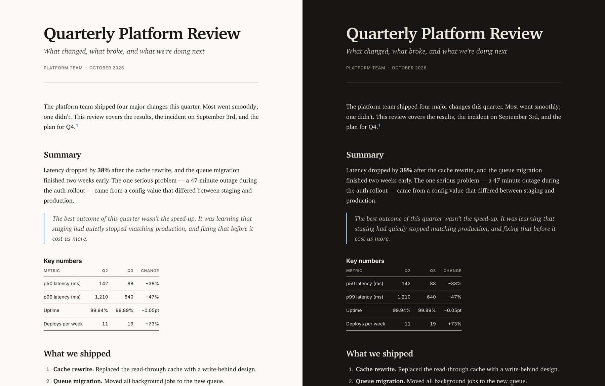

# Render

An agent skill that turns Markdown into documents worth sending: **HTML**, **Word (DOCX)** and **PDF**, with editorial typography in all three.



Ask your agent to `/render notes.md` (or "export this as a PDF") and you get `notes.html`, `notes.docx` and `notes.pdf` next to the source.

## Install

With the [skills CLI](https://skills.sh):

```bash
npx skills add TheSethRose/render-skill
```

Works with Claude Code, Codex, Cursor, OpenCode and any agent that reads `SKILL.md` skills. Add `-g` to install globally.

### Requirements

- [`uv`](https://docs.astral.sh/uv/). Pandoc comes bundled through `pypandoc-binary`, so there's nothing else to install.
- For PDF: Chrome, Chromium, Edge or Brave (or WeasyPrint as a fallback). No LaTeX.

## What you get

- **HTML**: one self-contained file (styles and images embedded) that follows light/dark mode.
- **PDF**: printed from the same HTML, with print sizing, page numbers, and headings, tables and code kept from splitting across pages.
- **DOCX**: styled through a bundled Word template (Georgia, Aptos, Consolas) so it looks right on the recipient's machine.

Supports GitHub-flavored Markdown plus YAML front matter (`title`, `subtitle`, `author`, `date`), footnotes, math, task lists, figures with captions, syntax highlighting and an optional table of contents.

## Use the script directly

```bash
uv run skills/render/scripts/render.py report.md                 # all three formats
uv run skills/render/scripts/render.py report.md -f pdf          # just a PDF
uv run skills/render/scripts/render.py docs/ -r -o out --toc     # a whole folder, with contents
```

| Option | Meaning |
| --- | --- |
| `-f html,docx,pdf` | Formats to produce (default: all) |
| `-o DIR` | Output folder (default: next to each source) |
| `-r` | Recurse into folders |
| `--toc` | Add a table of contents |
| `--css FILE` | Use your own stylesheet for HTML and PDF |
| `--reference-docx FILE` | Use your own Word template |

Try it on [`docs/example.md`](docs/example.md).

## Customize

- HTML and PDF look: edit [`skills/render/assets/style.css`](skills/render/assets/style.css).
- Word look: edit the palette and fonts in [`build_reference_docx.py`](skills/render/scripts/build_reference_docx.py), then run `uv run skills/render/scripts/build_reference_docx.py`.

## License

[MIT](LICENSE)
